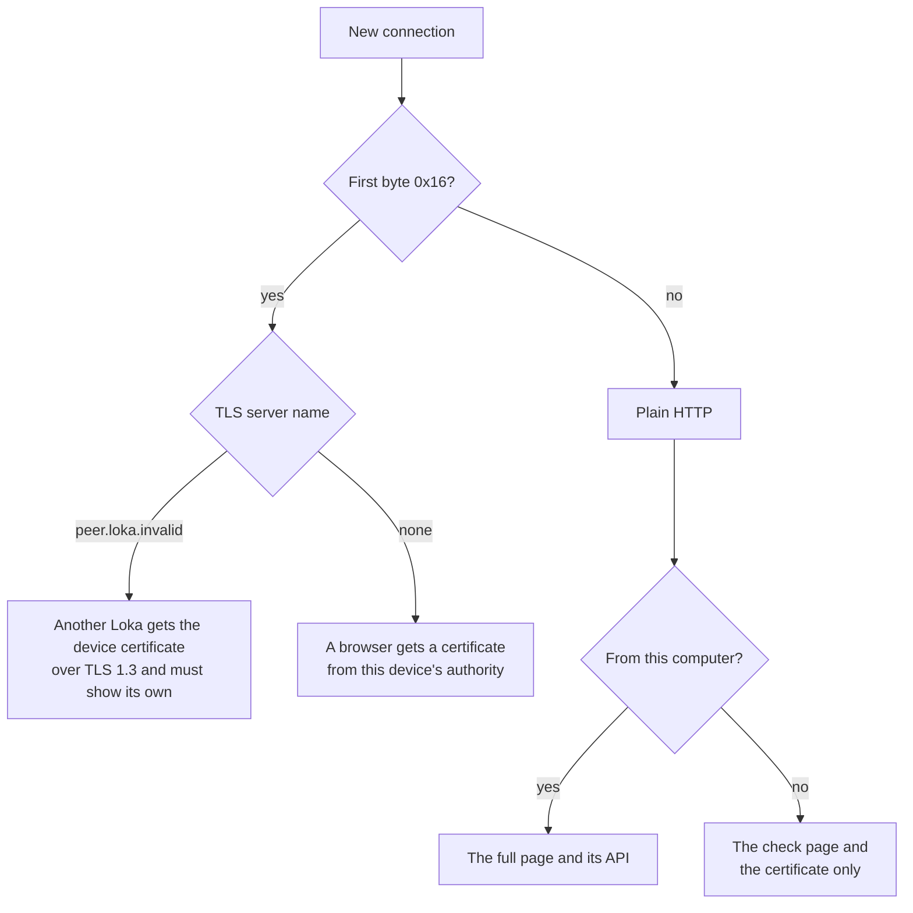
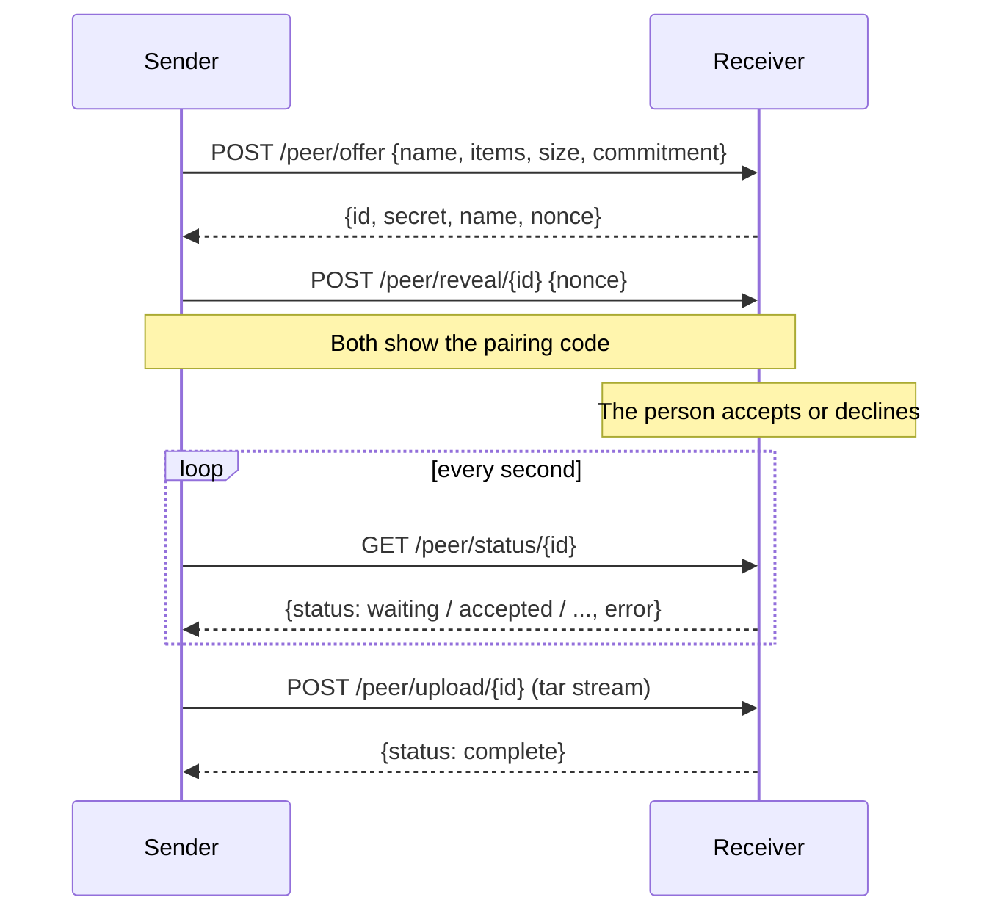

# How Loka devices talk

This is how Loka finds other devices, proves who they are and moves
files. Everything uses plain HTTP, TLS and JSON, so you can check it with
curl. The README covers using Loka.

## Finding devices

Every Loka sends a small JSON message to the multicast address
`239.255.45.87`, UDP port `45873`, every 3 seconds:

```json
{"service": "loka", "id": "…", "name": "my-laptop", "port": 45873}
```

`id` is the device's ID (see below), `name` its host name and `port` the
TCP port it listens on. A device that stays quiet for 12 seconds drops
off the list. Anyone on the network can send these messages, so Loka
uses them only to find addresses. It never trusts a device because of
them.

## One port, two kinds of connection

Loka listens on one TCP port, `45873` by default. It reads the first
byte of each connection to tell TLS from plain HTTP:



A connection has 10 seconds to send its first byte. Loka keeps at most 128
connections from other devices that aren't part of a transfer, whether
new, idle or busy with another request. Past that, it closes the oldest, so
connections that send nothing can't use up the file handles a transfer
needs. Loka doesn't count an upload with its secret or a download with its
link while it runs.

## Who is who

Each Loka makes two certificates on its first run and keeps them in its
settings folder (`~/.config/loka` on Linux):

| File | What | Lasts |
| --- | --- | --- |
| `identity.pem` | The device certificate. Its common name is a random ID. | Forever |
| `ca.pem` | A certificate authority for browsers | 10 years |
| `devices.json` | The devices it remembers: ID, name and SHA-256 of their certificate | |

Two Lokas connect with TLS 1.3, and each shows its device certificate.
No authority signs these certificates. Instead, each Loka remembers the
other's:

| The other device's ID is | And its certificate | Loka |
| --- | --- | --- |
| Not remembered | | Trusts it and shows it as new |
| Remembered | The same | Goes on |
| Remembered | Different | Refuses it, since another device may be posing as it |

Both devices remember each other once the receiver accepts a transfer.
A reinstalled Loka makes a new ID. So a changed certificate means another
device is using a remembered ID, which anyone can read from the
announcements. Loka refuses it, shows the refusal once per device, and
never suggests forgetting the device. `loka forget NAME` or
`loka forget ID` drops a remembered device. The first time two devices
meet, there is nothing to compare yet, which is what the pairing code below
is for.

The certificate authority may only vouch for local addresses: `10/8`,
`172.16/12`, `192.168/16`, `100.64/10`, `169.254/16`, `127/8`, `fc00::/7`,
`fe80::/10` and `::1`. Browsers reject anything else it signs, so someone
who copied it still couldn't pose as a web site. Carrier NAT and Tailscale
use `100.64/10`. For each of its addresses where phones can't trust it, Loka
shows a warning, and the phone's page at that address doesn't offer the
certificate. For each address a browser connects to, Loka makes a
certificate that lasts 397 days.

## Sending

The sender sends four requests, plus one to cancel. A phone's browser
sends the same ones, except the reveal.



- The offer lists up to 100 top-level names and the total size of the
  files. Up to 16 offers can wait at once, and more get `503`. An offer
  that nobody answers within a minute fails, and `/peer/status` then
  gives the reason in `error`.
- Every later request carries the `secret` in an `X-Transfer-Secret`
  header.
- The upload is a tar stream: a header per directory or file, then its
  bytes. The receiver unpacks it as it arrives, refuses paths that leave
  the destination, and stops if more arrives than was offered.
- Either side can cancel. The sender cancels with
  `POST /peer/cancel/{id}`. When the receiver cancels, the sender's next
  request fails.
- If no bytes move for a minute, each side ends the transfer as
  interrupted. A device that goes to sleep or loses its network can't
  say so, and without this limit the sender would wait up to 15 minutes.
- A Loka that sends checks the receiver's certificate on every
  connection of the transfer, and stops if it changes. When the device
  was picked from the list, the receiver's certificate must also have
  that device's ID.

A browser has no certificate, so the receiver lists it as "A browser
at" and its address. Its offer has no commitment and waits for an answer
at once. The phone page builds the tar stream itself.

## The pairing code

The code lets two people check that their Lokas talk to each other, and
not to another device that sits between them and passes everything on.
Each side picks a nonce, a random 32-byte number written in hex.

1. The offer carries `commitment`, the SHA-256 of `loka commit\0`
   followed by the sender's nonce, written as 64 hex digits. An offer with
   any other length gets `400`.
2. The receiver answers with its own nonce.
3. The sender reveals its nonce. If it doesn't match the commitment, the
   receiver stops the transfer.

Each side then makes the code. It joins five parts with a zero byte
between each: `loka code`, the sender's certificate fingerprint, the
receiver's, the sender's nonce and the receiver's. A fingerprint is the
SHA-256 of the certificate in lowercase hex. Loka takes the SHA-256 of
the result and reads its first 8 bytes as one number, most significant
byte first. The remainder after dividing that by 1,000,000 is the code,
shown as `123 456`.

A device in between shows its own certificate to each side, so the two
codes start from different fingerprints. To make them match anyway, it
would need to choose one nonce after seeing the other. It can't. The
sender commits to its nonce before it sees the receiver's, and the
receiver sends its nonce before it sees the sender's. That leaves the
device in between one chance in a million per offer.

The device in between could still offer to the receiver again and again,
work out the receiver's code from each answer, and reveal only the offer
whose code matches. So each offer from a Loka spends one of 10 tries. A try
comes back when the person accepts, and one more every 30 seconds. All new
devices share one set of tries, since anyone can make a new device ID. Each
remembered device has its own set, so it can still send when the others run
out. A remembered device, such as a guest's laptop, could also be the device
in between, so its own tries run out too. With no tries left, offers get
`429` and the receiver warns the person. An offer fails if its sender
doesn't reveal within 10 seconds.

On both sides a transfer between Lokas starts as `pairing` and moves to
`waiting` once that side knows the code. The receiver asks the person only
then, and both sides show the code while they wait.

## Download links

A link looks like `http://192.0.2.10:45873/#d=TOKEN`. Browsers never send
the part after `#`, so the token doesn't cross the network in plain text.
The page reads the token and opens `https://192.0.2.10:45873/download/TOKEN`.

One shared file downloads as it is. Several download as one zip file,
without compression. `loka share` serves only the page, the certificate
and the links.

## What it doesn't protect

- **A first contact without checking the code.** Loka trusts a new
  device as it is. Someone on the same network could sit between two
  devices that first time. The pairing code shows it only if you compare
  it.
- **The phone's first page and the certificate download.** Both go over
  plain HTTP. Compare the certificate's SHA-256 fingerprint on the phone
  with the one in the page's help.
- **Who uses a browser.** Anyone who can open the page can offer files,
  and anyone with a link can download while it's shared. The person at the
  receiver still accepts each offer.
- **Device names.** Anyone can announce any name.
