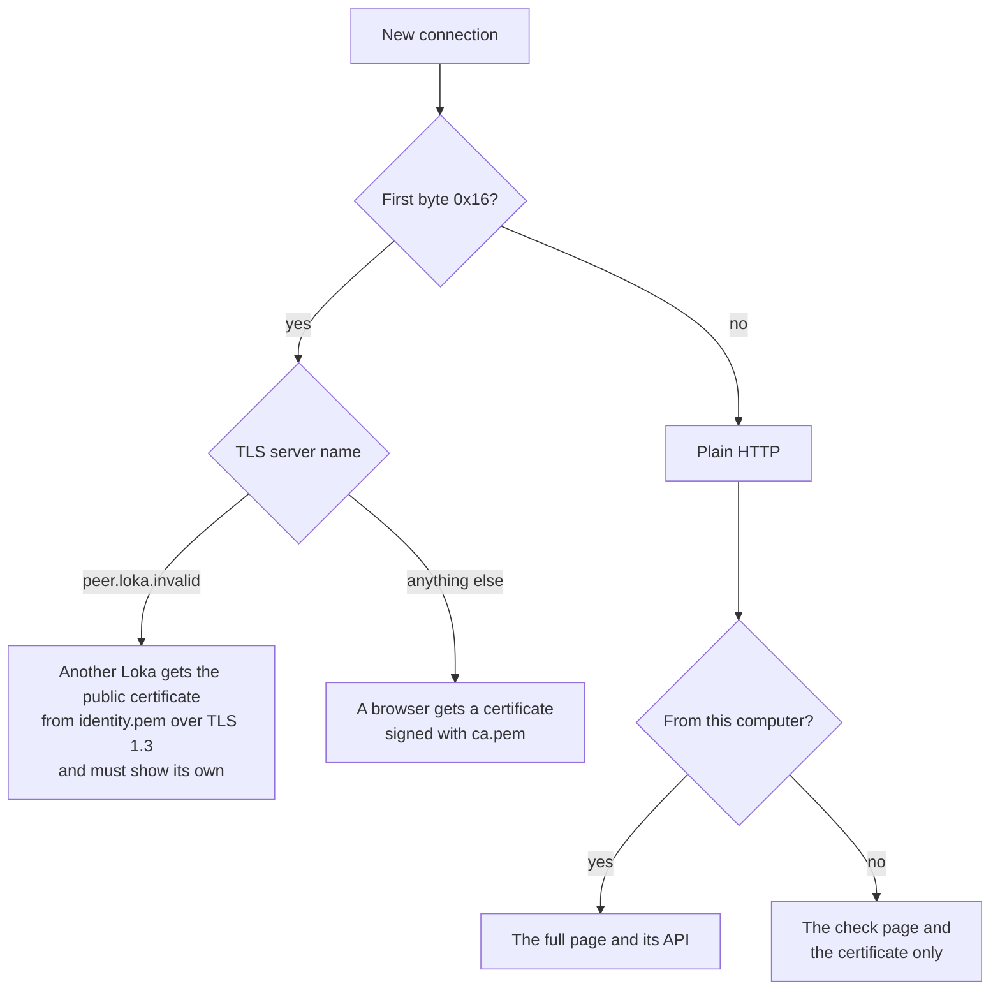
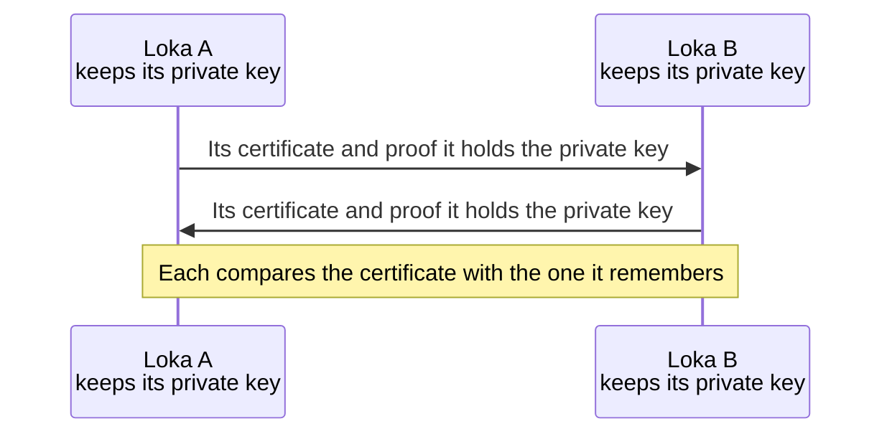
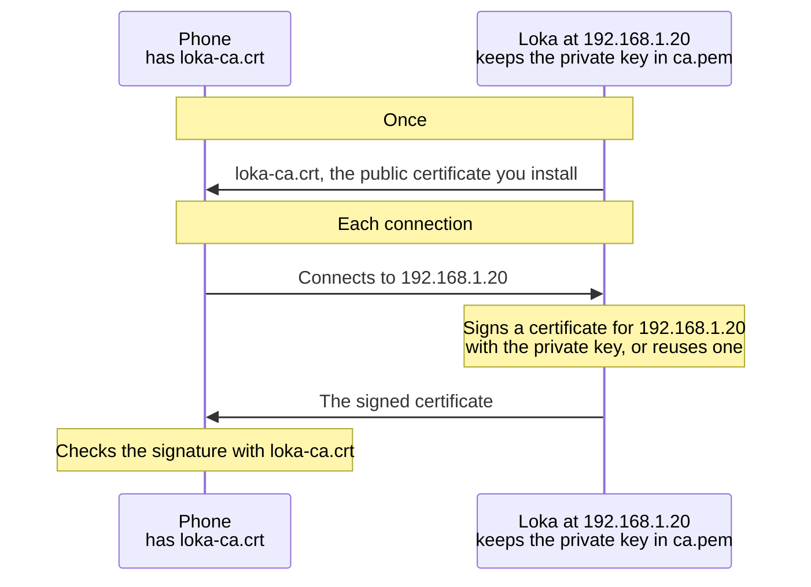
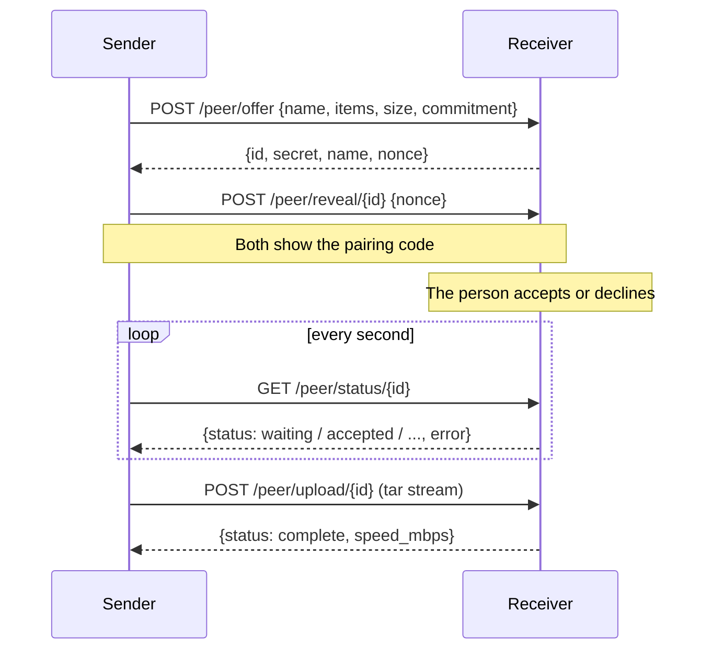

# How Loka devices talk

Loka shares files, directories and text on your local network. It finds
devices with UDP multicast and sends transfers directly over HTTPS. You can
inspect the HTTP requests with `curl`. For setup and commands, see the
[README](README.md).

## Finding devices

Every 3 seconds, Loka announces itself in a JSON message to
`239.255.45.87` on UDP port `45873`.

```json
{"service": "loka", "id": "…", "name": "my-laptop", "port": 45873}
```

`id` is the device ID, `name` is the device's host name and `port` is
the TCP port it listens on. Loka removes a device from the list after
12 seconds without an announcement. Anyone on the network can send
these messages, so Loka uses them only to find addresses.

## One port, two kinds of connection

Loka listens on one TCP port, `45873` by default. It reads the first byte
of each connection to tell TLS from plain HTTP.



A connection has 10 seconds to send its first byte. Loka counts all
connections from other devices except those handling an upload with
the right secret or a download with a valid link. If the count goes
over 128, Loka closes the oldest counted connection. Loka counts a
transfer connection again if it goes idle.

## Who is who

Each Loka makes two certificates on its first run and keeps them in its
settings directory, `~/.config/sprytnyk.dev/Loka` on Linux.

| File | Purpose | Lasts |
| --- | --- | --- |
| `identity.pem` | The device certificate. Its common name is a random ID. | Until the end of 9999 |
| `ca.pem` | A certificate authority for browsers. Phones install its certificate as `loka-ca.crt`. | 10 years |
| `devices.json` | The ID, name and certificate fingerprint for each remembered device | |
| `devices.lock` | Keeps two Loka processes from writing to `devices.json` at the same time | |

`identity.pem` and `ca.pem` each hold a private key and its certificate.
A certificate contains a public key, a name and the dates it is valid.
Loka shares the certificate and keeps the private key on the computer.

Loka uses remembered certificates much like SSH uses `known_hosts`.



| The other device's ID is | And its certificate | Loka |
| --- | --- | --- |
| Not remembered | | Shows it as new and asks for approval |
| Remembered | The same | Proceeds with the transfer |
| Remembered | Different | Refuses the transfer |

Both devices remember each other once the receiver accepts a transfer.
A new settings directory gets a new certificate and ID. A different
certificate with the same ID can mean another device copied the ID from
discovery messages. Loka shows the refusal once per device and keeps the
saved certificate. You can remove a remembered device with
`loka forget NAME` or `loka forget ID`. On the first transfer, check
that both devices show the same pairing code before you accept.

Install `loka-ca.crt` on the phone once. It contains the public certificate
from `ca.pem`. Loka uses the private key in `ca.pem` to sign a certificate
for each address. The phone checks the signature against `loka-ca.crt`.



For IP addresses, the authority is limited to `10.0.0.0/8`,
`172.16.0.0/12`, `192.168.0.0/16`, `100.64.0.0/10`, `169.254.0.0/16`,
`127.0.0.0/8`, `fc00::/7`, `fe80::/10` and `::1/128`. Carrier NAT
and Tailscale use `100.64.0.0/10`. For domain names, the authority is
limited to `.invalid`. These limits still apply if someone copies the
private key from `ca.pem`. Loka warns about addresses the authority
doesn't cover and hides the `loka-ca.crt` download at those addresses.

Each address's certificate lasts up to 397 days for compatibility with
phone browsers. Loka keeps those certificates in memory and creates
them as needed.

| What happens | Certificate the browser gets |
| --- | --- |
| A phone opens `http://192.168.1.20:45873/` and moves to HTTPS | A new one for `192.168.1.20` |
| The phone connects again | The same one |
| The computer's address changes to `192.168.1.21`, and the phone opens the new link | A new one for `192.168.1.21` |
| Loka restarts | A new one on the next connection |
| The phone connects when the certificate has a day or less left | A new one |

The link for `192.168.1.20` stops working when the computer no longer
uses that address.

## Sending

The sender offers the files, then both devices show a pairing code.
The sender waits for someone at the receiver to accept.



- The offer lists up to 100 top-level names and the total file size.
  The receiver allows 16 waiting offers. Browsers and new devices can
  take up to 12 of those places. The receiver returns `503` when it has
  no place for another offer. If nobody answers within a minute,
  `/peer/status` reports the failure in `error`.
- After the offer, the sender includes the `secret` in the
  `X-Transfer-Secret` header of each request for that transfer.
- The sender uploads the archive in one `POST /peer/upload/{id}`. The
  receiver writes files as they arrive and stops the upload after a
  minute without progress.
- The receiver refuses paths outside the destination. Before it moves
  the files into place, it checks their total size against the offer.
- The final reply reports the upload's average speed in `speed_mbps`.
  The phone displays that value in megabits per second. Loka senders
  ignore it.
- The sender cancels with `POST /peer/cancel/{id}`. If the receiver cancels,
  the sender's next request fails.
- The sender checks the receiver's certificate on every connection and
  stops if it changes. If you picked a device from the list, the sender
  also checks that the certificate has that device's ID.

### Browser uploads

- The browser has no Loka device certificate. The receiver labels the
  transfer with the browser's IP address.
- Pairing requires two device certificates. The receiver asks the person
  to accept or decline the offer without showing a pairing code.
- The page on the phone packs the files into the tar stream.

A browser's offer must include the `token` from the phone link. This
keeps a device without the link from posing as a browser to skip
pairing. The receiver's page and `loka receive` show the phone link.
In `http://192.168.1.20:45873/#r=TOKEN`, the browser keeps the part
after `#` on the phone and the page sends the token over HTTPS. Loka
makes a new token each time it starts and returns `403` if the browser
omits it or sends the wrong one.

Treat the phone link as a secret. An `http://` link loads the first page
over plain HTTP. Someone who can change traffic could swap in a page
that reads the token. The `https://` link protects the token on a phone
with the right `loka-ca.crt`.

### Text

Text uses `/peer/offer` and `POST /peer/upload/{id}`.

- The offer has `"kind": "text"` and an empty or omitted `items` list.
  `size` is the text's length in bytes, from 1 to 1,048,576.
- The upload body is the text in UTF-8. The receiver rejects invalid
  UTF-8 and checks that the byte count matches the offer.
- The receiver automatically accepts text offers from browsers with the
  receive token. A Loka sender that remembers the receiver sends
  `"receiver_known": true` with its nonce in `/peer/reveal/{id}`. If
  both Loka devices remember each other, the receiver also accepts
  automatically. Otherwise, it shows the pairing code and asks for
  approval. The text must arrive within a minute of acceptance.
- The receiver keeps text in memory until the person closes it in the browser
  or `loka receive` prints it. Each unread message takes one of the 16 places
  for waiting offers.

Older versions without text support return `400` with `Invalid offer`.

## The pairing code

Compare the codes to check that each device is talking to the other.
Each side generates 32 random bytes called a nonce and encodes them as
64 hex digits.

1. The sender hashes `loka commit`, a zero byte and the sender's
   hex-encoded nonce with SHA-256. The offer includes the resulting hash
   as a 64-character lowercase hex string in `commitment`. The receiver
   returns `400` if the commitment has a different length.
2. The receiver answers with its own nonce.
3. The sender reveals its nonce. The receiver hashes it the same way
   and stops the transfer if the result differs from the commitment.

Each side joins `loka code`, the sender's certificate fingerprint, the
receiver's certificate fingerprint, the sender's hex-encoded nonce and
the receiver's hex-encoded nonce. It inserts one zero byte between
adjacent parts. A fingerprint is the SHA-256 of the certificate in
lowercase hex. Loka hashes the joined bytes with SHA-256 and reads the
first eight bytes as an unsigned integer, most significant byte first.
It divides that number by 1,000,000 and shows the remainder as six
digits in two groups of three, for example `123 456`.

A device passing traffic between the sender and receiver shows its own
certificate to each side, so the two codes start from different
fingerprints. The sender commits to its nonce before seeing the
receiver's nonce. The receiver sends its nonce before seeing the
sender's nonce. This leaves the device passing traffic one chance in a
million per offer to make the codes match.

A device in between could make repeated offers and reveal its nonce
only when the receiver's code matches. To limit those attempts, each
offer from a Loka uses one of 10 tries. Accepting an offer restores its
try. The receiver also restores one try every 30 seconds. All new
devices share the same 10 tries because anyone can make a new device ID.
Each remembered device has its own 10 tries and can still send when
others run out. When a device has no tries left, the receiver returns
`429` and shows a warning. An offer expires if the sender takes more
than 10 seconds to reveal its nonce.

Each Loka starts the transfer in `pairing` and moves it to `waiting`
when it has the code. The receiver then asks the person to accept or
decline. Both devices show the code while they wait.

## Download links

A link looks like `http://192.168.1.20:45873/#d=TOKEN`. The browser keeps
the part after `#` on the phone. The page reads the token and opens
`https://192.168.1.20:45873/download/TOKEN`. A phone with `loka-ca.crt` can
open `https://192.168.1.20:45873/#d=TOKEN` and skip the plain page.

`loka share` prints a `curl` command that checks the SHA-256 of the
server's public key with `--pinnedpubkey`. Loka uses the same key for
every address until it restarts.

Loka sends a single shared file in its original format. For a directory
or multiple files, Loka builds an uncompressed ZIP archive during the
download.

A text link looks like `http://192.168.1.20:45873/#t=TOKEN`. The page
switches to HTTPS the same way and fetches the text from
`https://192.168.1.20:45873/download/TOKEN`. The response is `text/plain`.
The page shows the text with a **Copy** button. `loka share` serves only
the page, the certificate and the links.

## What it doesn't protect

- **A first transfer without a code check.** Someone on the same network
  could pass traffic between the devices. Accept only if both devices
  show the same code.
- **`http://` addresses and the download of `loka-ca.crt`.** Both go over
  plain HTTP. Someone who can change traffic could swap the first page and
  steal a link or the files a phone sends. They could also swap
  `loka-ca.crt` for their own. Compare the SHA-256 fingerprint in
  the phone's settings with the one shown on the computer, under
  **?** in Loka or in the terminal. Someone who swaps the certificate
  could also change the fingerprint shown on the phone's web page.
  Use `https://` once the phone trusts the correct certificate.
- **Who uses a browser.** Anyone with the phone link can offer files and
  send text. The person at the receiver still accepts each file offer.
  Loka shows text immediately and keeps it in memory. Anyone with a
  download link can use it while it's shared.
- **Device names.** Anyone can announce any name.
