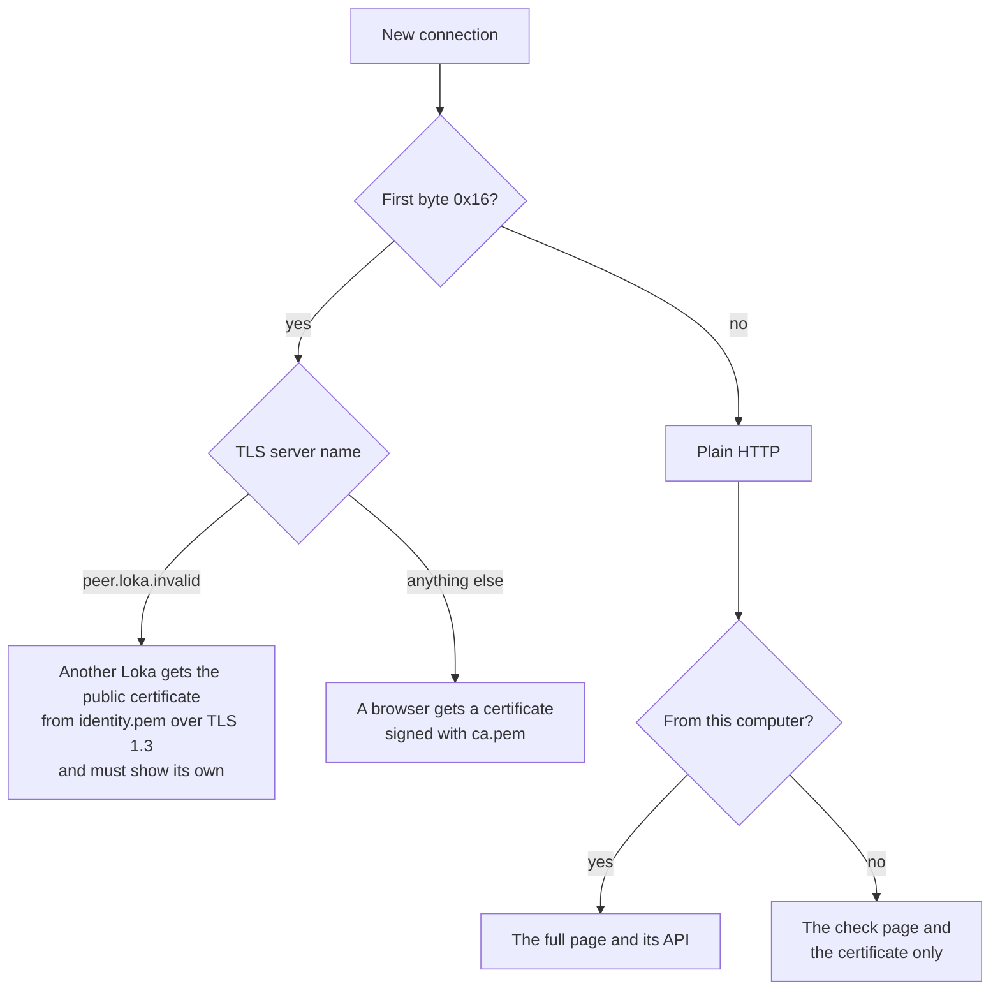
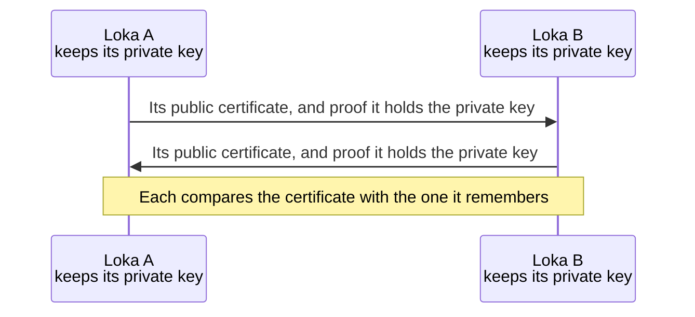
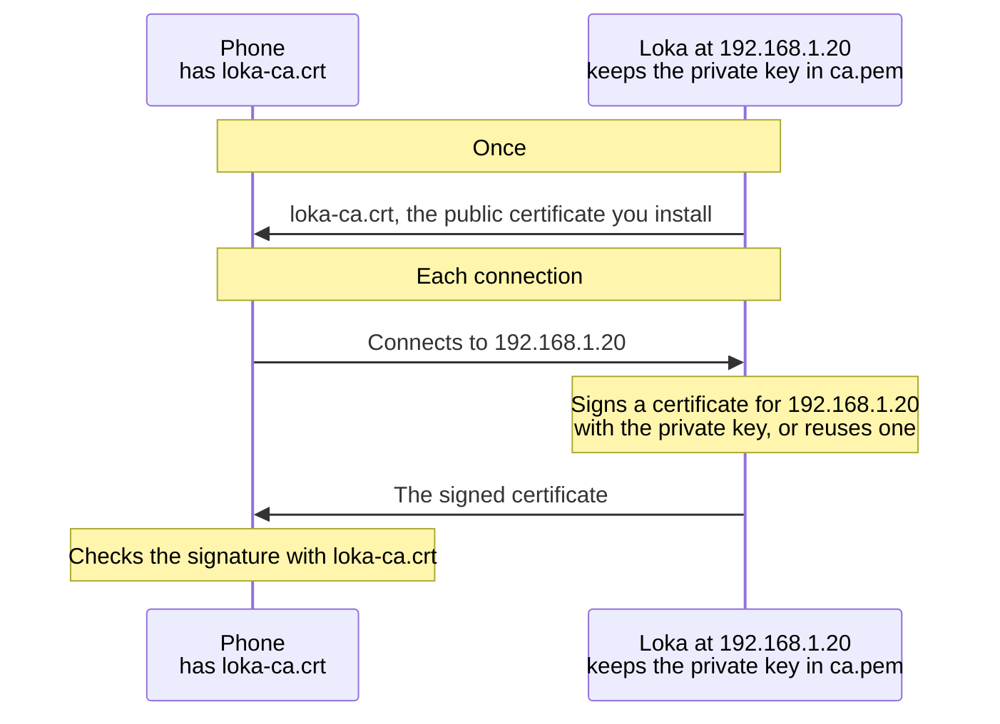
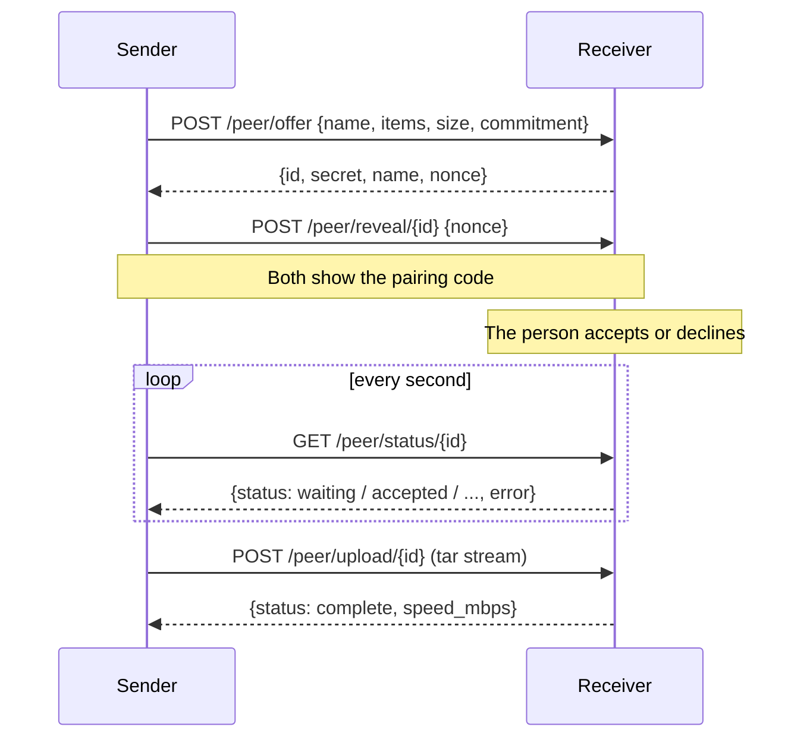

# How Loka devices talk

This is how Loka finds other devices, proves who they are and moves
files. Everything is HTTP, TLS and JSON, so you can check it with curl.
The README covers using Loka.

## Finding devices

Every Loka sends a small JSON message to the multicast address
`239.255.45.87`, UDP port `45873`, every 3 seconds:

```json
{"service": "loka", "id": "…", "name": "my-laptop", "port": 45873}
```

`id` is the device's ID (see below), `name` its host name and `port` the
TCP port it listens on. A device that stays quiet for 12 seconds drops
off the list. Anyone on the network can send these messages, so Loka
uses them only to find addresses. It never trusts a device because of
them.

## One port, two kinds of connection

Loka listens on one TCP port, `45873` by default. It reads the first
byte of each connection to tell TLS from plain HTTP:



A connection has 10 seconds to send its first byte. Loka keeps at most 128
connections from other devices that aren't part of a transfer, whether
new, idle or busy with another request. Past that, it closes the oldest, so
connections that send nothing can't use up the file handles a transfer
needs. A connection stops counting once it sends an upload with the right
secret or a download with a working link.

## Who is who

Each Loka makes two certificates on its first run and keeps them in its
settings directory, `~/.config/sprytnyk.dev/Loka` on Linux:

| File | What | Lasts |
| --- | --- | --- |
| `identity.pem` | The device certificate. Its common name is a random ID. | Forever |
| `ca.pem` | A certificate authority for browsers. Phones install its certificate as `loka-ca.crt`. | 10 years |
| `devices.json` | The devices it remembers: ID, name and SHA-256 of their certificate | |
| `devices.lock` | A Loka locks it while it changes `devices.json`, so two Lokas running at once don't lose each other's changes | |

`identity.pem` and `ca.pem` each hold a private key and its certificate,
like an SSH key pair. A certificate is the public key with a name and
dates. The private key never leaves the computer. Others get only the
public certificate.

Two Lokas work like SSH and its `known_hosts` file. The first time, each
remembers the other's certificate. Later, it refuses a device that shows a
different one:



What Loka does depends on whether it remembers the other device:

| The other device's ID is | And its certificate | Loka |
| --- | --- | --- |
| Not remembered | | Trusts it and shows it as new |
| Remembered | The same | Goes on |
| Remembered | Different | Refuses it, since another device may be posing as it |

Both devices remember each other once the receiver accepts a transfer.
A Loka's certificate never changes, and a Loka with a new settings
directory makes a new ID. So when a remembered ID shows a different
certificate, another device copied that ID from the announcements. Loka
refuses it, shows the refusal once per device, and never suggests
forgetting the device. `loka forget NAME` or `loka forget ID` drops a
remembered device. The first time two devices meet, there is nothing to
compare yet, which is what the pairing code below is for.

A phone can't remember certificates that way. Instead, you install the
certificate from `ca.pem` on it once, as `loka-ca.crt`. Loka signs a
certificate for each of its addresses with the private key from `ca.pem`,
and the phone checks the signature with `loka-ca.crt`:



The certificate authority may only vouch for local addresses: `10/8`,
`172.16/12`, `192.168/16`, `100.64/10`, `169.254/16`, `127/8`, `fc00::/7`,
`fe80::/10` and `::1`. Browsers reject anything else it signs, so someone
who copied `ca.pem`, private key included, still couldn't pose as a web
site. Carrier NAT and Tailscale use `100.64/10`. If the computer has an
address outside these ranges, Loka warns about it. The page at that address
doesn't offer `loka-ca.crt`.

`ca.pem` lasts 10 years. Each address's certificate lasts 397 days, the
most phones accept. Loka keeps those only in memory and makes them again
when needed. For example:

| What happens | Certificate the browser gets |
| --- | --- |
| A phone opens `http://192.168.1.20:45873/` and moves to HTTPS | A new one for `192.168.1.20` |
| The phone connects again | The same one |
| The computer's address changes to `192.168.1.21`, and the phone opens the new link | A new one for `192.168.1.21` |
| Loka restarts | A new one on the next connection |
| Loka keeps running for 396 days, so the one in use would run out the next day | A new one, so it never runs out |

The link for `192.168.1.20` stops working once the computer leaves that
address.

## Sending

The sender sends four requests, plus one to cancel. A phone's browser
sends the same ones, except the reveal.



- The offer lists up to 100 top-level names and the total size of the
  files. Up to 16 offers can wait at once, and more get `503`. Browsers
  and new devices may take only 12 of those places, so 4 are always left
  for remembered devices. An offer that nobody answers within a minute
  fails, and `/peer/status` then gives the reason in `error`.
- Every later request carries the `secret` in an `X-Transfer-Secret`
  header.
- The upload is a tar stream: a header per directory or file, then its
  bytes. The receiver unpacks it as it arrives, refuses paths that leave
  the destination, and stops if more arrives than was offered.
- When the upload completes, the receiver's answer includes the average
  speed in `speed_mbps`, in megabits a second. The receiver measures it
  from when the upload starts until it completes. A Loka that sends
  ignores it. The phone page shows it.
- Either side can cancel. The sender cancels with
  `POST /peer/cancel/{id}`. When the receiver cancels, the sender's next
  request fails.
- If no bytes move for a minute, each side ends the transfer as
  interrupted. A device that goes to sleep or loses its network can't
  say so, and without this limit the sender would wait up to 15 minutes.
- A Loka that sends checks the receiver's certificate on every
  connection of the transfer, and stops if it changes. When the device
  was picked from the list, the receiver's certificate must also have
  that device's ID.

A phone sends from its browser, which differs from a Loka in three ways:

- It has no certificate, so the receiver can't remember it. The receiver
  shows the transfer as "From a browser at 192.168.1.30", with the phone's
  address.
- There's no pairing code, since it needs both devices' certificates. The
  offer goes straight to the person at the receiver, who accepts or
  declines it.
- The page on the phone packs the files into the tar stream itself.

A browser shows no pairing code, so a device between two Lokas could pose
as one to the receiver. To stop that, a browser's offer must carry
`token`, the receive token. It is in the phone link,
`http://192.168.1.20:45873/#r=TOKEN`, which the receiver's page and
`loka receive` show. Browsers never send the part after `#`, and the page
sends the token only over HTTPS. Loka makes a new token on each start.
Offers without it get `403`.

Treat the phone link as a secret. The page an `http://` link opens comes
over plain HTTP, so someone who can change traffic could swap it for one
that reads the token. Over the `https://` link, on a phone with the right
`loka-ca.crt`, they can't read it.

### Text

Text goes the same way as files, with these differences:

- The offer has `"kind": "text"` and no `items`. `size` is the text's length
  in bytes, at most 1 MB (1,048,576).
- The upload is the text itself in UTF-8, not a tar stream. The receiver
  refuses text that isn't valid UTF-8 or isn't the size offered.
- Text from a browser with the receive token moves straight to `accepted`.
  A Loka that remembers the receiver sends `"receiver_known": true` with
  its nonce in `/peer/reveal`. The receiver skips the prompt only if it
  also remembers the sender. Otherwise, it shows the code and waits for
  the person's answer. Accepted text must arrive within a minute.
- The receiver keeps the text in memory, never on disk, and drops it once
  the person closes it. Until then it takes one of the 16 places for waiting
  offers, so text that keeps coming can't fill the memory.

A Loka from before text answers a text offer with `400` and `Invalid offer`.
`loka receive` answers `400` too, since it can't show text yet.

## The pairing code

The code lets two people check that their Lokas talk to each other, and
not to another device that sits between them and passes everything on.
Each side picks a nonce, a random 32-byte number written in hex.

1. The offer carries `commitment`, the SHA-256 of `loka commit\0`
   followed by the sender's nonce, written as 64 hex digits. An offer with
   any other length gets `400`.
2. The receiver answers with its own nonce.
3. The sender reveals its nonce. If it doesn't match the commitment, the
   receiver stops the transfer.

Each side then makes the code. It joins five parts with a zero byte
between each: `loka code`, the sender's certificate fingerprint, the
receiver's, the sender's nonce and the receiver's. A fingerprint is the
SHA-256 of the certificate in lowercase hex. Loka takes the SHA-256 of
the result and reads its first 8 bytes as one number, most significant
byte first. The remainder after dividing that by 1,000,000 is the code,
shown as `123 456`.

A device in between shows its own certificate to each side, so the two
codes start from different fingerprints. To make them match anyway, it
would need to choose one nonce after seeing the other. It can't. The
sender commits to its nonce before it sees the receiver's, and the
receiver sends its nonce before it sees the sender's. That leaves the
device in between one chance in a million per offer.

The device in between could still offer to the receiver again and again,
work out the receiver's code from each answer, and reveal only the offer
whose code matches. So each offer from a Loka spends one of 10 tries. A try
comes back when the person accepts, and one more every 30 seconds. All new
devices share one set of tries, since anyone can make a new device ID. Each
remembered device has its own set, so it can still send when the others run
out. A remembered device, such as a guest's laptop, could also be the device
in between, so its own tries run out too. With no tries left, offers get
`429` and the receiver warns the person. An offer fails if its sender
doesn't reveal within 10 seconds.

On both sides a transfer between Lokas starts as `pairing` and moves to
`waiting` once that side knows the code. The receiver asks the person only
then, and both sides show the code while they wait.

## Download links

A link looks like `http://192.168.1.20:45873/#d=TOKEN`. Browsers never send
the part after `#`, so the token doesn't cross the network in plain text.
The page reads the token and opens
`https://192.168.1.20:45873/download/TOKEN`. A phone with `loka-ca.crt` can
open `https://192.168.1.20:45873/#d=TOKEN` and skip the plain page.

`loka share` prints a curl command with `--pinnedpubkey`, the SHA-256 of the
public key in the per-address certificates. They all share one key, which
Loka makes on each start, so the command works only until Loka restarts.

One shared file downloads as it is. Several download as one zip file,
without compression.

A text link looks like `http://192.168.1.20:45873/#t=TOKEN`. The page moves
to HTTPS the same way, reads
`https://192.168.1.20:45873/download/TOKEN`, which serves the text as
`text/plain`, and shows it with a button to copy it. `loka share` serves only the page, the certificate
and the links.

## What it doesn't protect

- **A first contact without checking the code.** Loka trusts a new
  device as it is. Someone on the same network could sit between two
  devices that first time. The pairing code shows it only if you compare
  it.
- **`http://` addresses and the download of `loka-ca.crt`.** Both go over
  plain HTTP. Someone who can change traffic could swap the first page and
  steal a link or the files a phone sends. They could also swap
  `loka-ca.crt` for their own. To catch that, compare the SHA-256
  fingerprint in the phone's settings with the one on the computer, on
  Loka's page there or in the terminal. Loka's page on the phone came over
  plain HTTP too, so don't use a fingerprint from it. Use `https://` once
  the phone has the right `loka-ca.crt`.
- **Who uses a browser.** Anyone with the phone link can offer files and
  send text, and anyone who gets a link can download while it's shared. The
  person at the receiver still accepts each offer of files. Text shows at
  once, but never touches the disk.
- **Device names.** Anyone can announce any name.
