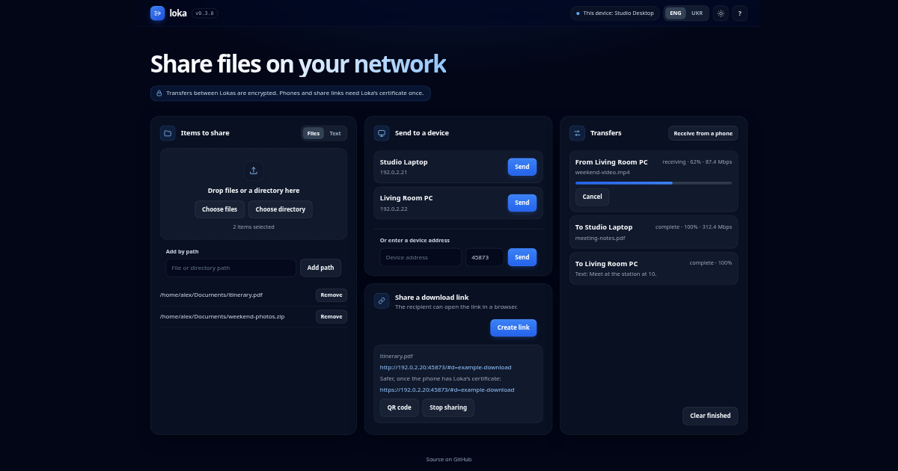

# Loka

Share files and directories with computers on the same local network. Loka is
a single program with nothing else to install.



## Install

Download the archive for your computer from
[Releases](https://github.com/sprytnyk/loka/releases), unpack it, and put
`loka` (`loka.exe` on Windows) in a directory on your `PATH`.

| Computer | Archive |
| --- | --- |
| Mac with Apple silicon | `loka_X.Y.Z_darwin_arm64.tar.gz` |
| Mac with Intel | `loka_X.Y.Z_darwin_amd64.tar.gz` |
| Linux | `loka_X.Y.Z_linux_amd64.tar.gz` |
| Windows | `loka_X.Y.Z_windows_amd64.zip` |

macOS refuses to open downloaded programs from unidentified developers. After
unpacking, run `xattr -d com.apple.quarantine loka` once.

To check a download, put `SHA256SUMS` and `SHA256SUMS.asc` from the release
next to it and run:

```sh
gpg --verify SHA256SUMS.asc SHA256SUMS && sha256sum --ignore-missing -c SHA256SUMS
```

With Go installed, you can instead run
`go install github.com/sprytnyk/loka@latest`.

## Start

Run `loka` on both computers. Loka opens in your browser.

Choose or drop files or a directory, then choose the receiving device. If it
does not appear, enter its address and port. Some Wi-Fi networks block
connections between devices. On Windows, allow Loka through the firewall when
asked. On the receiver, choose an existing destination directory and accept the
transfer. Loka remembers your destination until it stops. Several transfers can
arrive at the same time.

When you send or share dropped files, Loka keeps a temporary copy until it
stops. **Choose files**, **Choose directory**, and **Add by path** let Loka read
the originals. The pickers use zenity or kdialog on Linux, Finder on macOS, and
the usual dialog on Windows. You can type the destination directory when
receiving a transfer.

Loka puts incoming files in a hidden directory inside the destination and moves
them into place when the transfer finishes, so nothing is overwritten and a
failed transfer leaves nothing behind.

## Download links

Choose what to share and select **Create link**. Enter your local address if
Loka cannot find it. The recipient can open the link in a browser while you're
sharing.

Loka sends a single file as-is, and an interrupted download can resume. It
builds a ZIP as you download a directory or multiple files. Each download reads
the current contents. If a shared file or directory goes missing or gets
replaced, the link stops working.

## Command line

```sh
loka receive
loka devices
loka send --to 192.0.2.10 /path/to/file /path/to/directory
loka share --address 192.0.2.10 /path/to/file
```

Use your receiver's address with `send`. For `share`, use your own address or
omit `--address` to let Loka choose it. Press Ctrl+C to stop sharing. Leave the
destination empty to decline an incoming transfer.

Run `loka -h` for all options and `loka --version` for the version. If the
listening port is busy, use `--port 0` to pick a free port.

Use Loka on networks you trust. Transfers are unencrypted, and anyone with the
link can download while you're sharing. Restart interrupted transfers from the
beginning. Loka leaves symbolic links out of the directories you choose, so
choose the original files and directories instead.

## Development

Run `make check` for gofmt, go vet and the tests, and `make format` to format
the code. `make build` builds `dist/loka` for this computer, and
`make release` builds the release archives for every system into `dist/`. The
release script checks `--version` and `-h` before it creates the archives.
