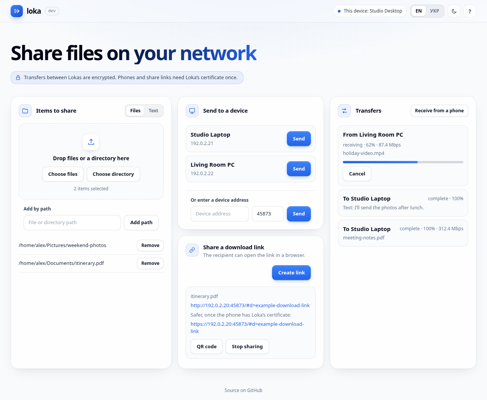

# Loka

[](https://github.com/sprytnyk/loka/releases/latest)
[](#install)
[](LICENSE)

[](https://codecov.io/gh/sprytnyk/loka)


Loka shares files, directories and text on your local network. Unpack one
executable for Linux, Windows or macOS and run it. It opens in your browser
and has terminal commands for file transfers. You don't need an installer
or extra software.

Phones and other computers can send and receive in their browser. Loka
finds computers running Loka on the same network. It encrypts transfers
and sends them directly between devices, even when the internet is down.
You don't need an account.

<picture>
  <source media="(prefers-color-scheme: dark)" srcset="docs/loka.png">
  
</picture>

## Install

Download the archive for your computer from
[Releases](https://github.com/sprytnyk/loka/releases) and unpack it.
On Windows, double-click `loka.exe`. On Linux or macOS, run `./loka` from
the unpacked directory. To run Loka from any directory in the terminal,
put the executable on your `PATH`.

| Computer | Archive |
| --- | --- |
| Mac with Apple silicon | `loka_X.Y.Z_darwin_arm64.tar.gz` |
| Mac with Intel | `loka_X.Y.Z_darwin_amd64.tar.gz` |
| Linux | `loka_X.Y.Z_linux_amd64.tar.gz` |
| Windows | `loka_X.Y.Z_windows_amd64.zip` |

> [!NOTE]
> If macOS blocks Loka because it doesn't recognise the developer, run
> `xattr -d com.apple.quarantine loka` once from the unpacked directory.

Put `SHA256SUMS` and `SHA256SUMS.asc` from the release alongside the archive.
Run this command to check the download.

```sh
gpg --verify SHA256SUMS.asc SHA256SUMS && sha256sum --ignore-missing -c SHA256SUMS
```

With Go installed, you can instead run
`go install github.com/sprytnyk/loka@latest`.

## Send and receive

Run `loka` on both computers. It opens in your browser.

1. Choose files or a directory, drop them on the page, or enter a path.
2. Select the receiving device. If it doesn't show up, enter its address and
   port.
3. On the receiving computer, pick an existing directory and accept within a
   minute. The first time, check that both computers show the same pairing code.

Loka can receive several transfers at once. It shows the current speed and
the average when a transfer finishes, in the browser and terminal. It
remembers the last destination until you quit.

Loka uses your system theme and your browser language. Switch between light
and dark or English and Ukrainian in the header. The browser remembers your choices.

To choose files or directories, Loka uses zenity or kdialog on Linux, Finder on
macOS, and the Windows file dialog. If the picker is unavailable, drop files
or enter their paths.

Loka copies dropped files because the browser keeps their paths private. It
deletes those copies when you quit. Files you pick or add by path stay where they are.

Loka puts incoming files in a hidden directory until the transfer finishes.
If `report.pdf` already exists in the destination, Loka saves the incoming
file under a name like `report (1).pdf`. If the transfer fails, Loka removes
the temporary files.

> [!TIP]
> If the computers can't see each other, the Wi-Fi network may block
> connections between devices. On Windows, allow Loka through the firewall when
> asked.

## From a phone

On the computer, select **Receive from a phone**. Scan the QR code with the
phone's camera or open the full link in its browser. Keep the part after `#r=`.
It lets the phone send and changes each time Loka starts.

Choose files or a directory and send them. The computer asks you to accept.
On iPhone and iPad, choose files because their browsers can't select directories.
To send text, switch to **Text** and paste it. See [Text](#text).

The first time, Loka shows how to install its certificate on Android or iPhone.
Install it once to open the page over HTTPS without a warning. If you skip it,
Loka still encrypts the connection and the browser warns that it can't verify
which computer answered.

Loka can show several addresses and QR codes, including one for Tailscale.
Use the code on the same network as the phone. Loka shows other VPN addresses
only when there is no local network.

## Download links

Add what you want to share and select **Create link**. Anyone with the link can
open it in a browser while you're sharing. Select **QR code** to show one code
per address for a phone to scan.

A link looks like `http://192.0.2.10:45873/#d=…`. The browser keeps the part
after `#` on the device. The page switches to HTTPS before it sends the
secret from the link. Each link also has an `https://` version. In the QR
code window, check **The phone has Loka's certificate** to show HTTPS codes.

> [!WARNING]
> An `http://` link opens a small page over plain HTTP first. Someone on the
> network who can change traffic could swap that page and steal the link. Once
> a phone has Loka's certificate, use the `https://` link instead. The same
> goes for the address in **Receive from a phone**.

Loka sends a single file in its original format. The browser can resume that
download if it stops. For a directory or several files, Loka builds a ZIP during
the download. Each download gets the current contents. Deleting or replacing a
shared file or directory stops the link.

## Text

In **Items to share**, select **Text** and type or paste a message. The
**Paste** button reads your clipboard if the browser allows it. Select a
device to send the text or select **Create link** for a phone.

- The receiving computer shows the text in a window with a **Copy** button.
  Loka keeps the text in memory until you close the window.
- If either device is new to the other, check the pairing code and
  accept on the receiving computer. Once both remember each other, text
  shows at once.
- On a phone, open the link from **Receive from a phone** and select **Text**.
  The text appears on the computer at once.
- A text link shows the text with a **Copy** button. It works until you stop
  sharing or quit Loka.

Text can be up to 1 MB. `loka receive` can't show text yet, so it refuses it.

## Command line

```sh
loka receive
loka devices
loka send --to 192.0.2.10 /path/to/file /path/to/directory
loka share /path/to/file
loka forget my-laptop
```

- `receive` asks where to put each file transfer. Leave the answer empty to
  decline. It refuses text and prints the phone link, its QR code, its HTTPS
  version and the certificate fingerprint.
- `devices` lists devices running Loka on the same network. It marks a device
  as remembered only when it shows the certificate Loka knows for it.
- `send` takes the receiver's address.
- `share` prints a link and its QR code for each local address, the same links
  over `https://`, the certificate's fingerprint and a `curl` command. The link
  works until you press Ctrl+C. `--address` limits it to one address.
- `forget` forgets a device.

The command uses `-k` because curl doesn't trust Loka's certificate by
default. The `--pinnedpubkey` option checks the key for this run. If another
device answers, curl stops before it sends the link.

Run `loka -h` for all options and `loka --version` for the version. If the
default port is busy, try `loka --port 45000`. Help and errors are in colour
in a terminal. Set `NO_COLOR=1` to turn that off.

## Safety

| Between | Encrypted |
| --- | --- |
| Two computers running Loka | Yes |
| A phone's browser and Loka | Yes |
| Download links | Yes |

Loka opens its page at `http://127.0.0.1`, an address that only works on your
computer. The **?** button explains how Loka protects transfers.
[PROTOCOL.md](PROTOCOL.md) describes how devices connect and transfer files.

Loka makes a certificate on its first run and keeps it in your settings
directory. It uses `~/.config/sprytnyk.dev/Loka` on Linux,
`~/Library/Application Support/sprytnyk.dev/Loka` on macOS and
`%AppData%\sprytnyk.dev\Loka` on Windows. Both devices mark each other as
new on the first transfer.

Loka calculates a six-digit pairing code from both certificates and a
random number from each side. Both devices show the code.

> [!IMPORTANT]
> The first time two devices talk, check that both show the same pairing code.
> If another device sits between them and passes the transfer on, the codes
> differ.

After the first transfer between computers running Loka, each remembers the
other's certificate. Loka refuses a transfer if a remembered device shows a
different certificate. A reinstalled copy shows up as a new device.

Loka keeps its browser certificate authority in the same directory. Installing
it on a phone lets the browser check which computer answered. The certificate
only covers local network addresses, so someone can't use it to pose as a
website. Loka leaves the computer's trusted certificates alone.

Loka uses plain HTTP for two steps.

1. The page an `http://` link or QR code opens first. It moves the phone to
   HTTPS.
2. The certificate download that page offers.

Someone on the same network could swap either one. Once the phone has the
certificate, use `https://` links, which skip the first page.

> [!IMPORTANT]
> Check the certificate before you trust it. It downloads over plain HTTP, so
> someone on the network could swap it for their own. Compare the SHA-256
> fingerprint in the phone's settings with the one on the computer. It's in
> the **?** help on Loka's page, and `loka receive` and `loka share` print it.
> Don't use a fingerprint from Loka's page on the phone. That page came over
> plain HTTP too, so whoever swapped the certificate could swap the page.
>
> On Android, search Settings for "Trusted credentials" and open the **User**
> tab. On iPhone, open **Settings › General › VPN & Device Management**, then
> the Loka profile and **More Details**. Don't check the padlock in the
> browser. It shows a different certificate, which Loka makes for each
> address, so its fingerprint never matches.

> [!CAUTION]
> Anyone who gets the link can download while you're sharing, so send it only
> to people you mean to. When you're done, select **Stop sharing**, or press
> Ctrl+C after `loka share`.

An interrupted transfer starts over. If no bytes move for a minute, for
example because a laptop went to sleep, the transfer stops. Loka skips
symbolic links inside the directories you choose.

## How Loka compares

| Tool | What you run on a computer | Browser on another device | Where it works | File encryption |
| --- | --- | --- | --- | --- |
| **[Loka](https://github.com/sprytnyk/loka/releases/latest)** | One file with a built-in web page and terminal commands | Send and receive in a browser on the same network. You accept each upload to the computer. | Finds other Loka devices on the same network. Works without internet access. | End-to-end encrypted |
| [croc](https://github.com/schollz/croc) | One terminal program | Use a code to send or receive on the [croc website](https://getcroc.com/). | Local terminal transfers work without internet access. The website and some internet transfers use a remote server to forward files. | End-to-end encrypted |
| [st](https://github.com/chyok/st) | One terminal program | Send and receive in a browser on the same network. st saves uploads automatically. | Finds other st devices on the same network. Works without internet access. | Plain HTTP |
| [LocalSend](https://localsend.org/) | Desktop app or separate terminal tool | Send and receive in a browser on the same network. LocalSend also has a separate [web app](https://github.com/localsend/web). | Desktop and phone apps work on the same network without internet access. By default, the web app uses a remote server to connect devices. | Encrypts app transfers by default |
| [Flashbyte](https://github.com/iamsami101/Flashbyte) | Desktop app | Flashbyte app on both devices | Local network. Works offline. | Supports TLS |
| [Upgopher](https://wanetty.github.io/upgopher/) | One file with a built-in web page | Upload and download from the shared directory. | Connect to the computer on your local network. You can also set up access over the internet. | Optional HTTPS and browser file encryption |
| [Dropwire](https://muhamadjawdatsalemalakoum.github.io/dropwire/) | Desktop app | Dropwire app on both devices | Finds devices on the same network and can send over the internet. A public server forwards files when a direct connection fails. | End-to-end encrypted |
| [PeerPayload Connect](https://github.com/Aditya-Karn234/PeerPayload) | Windows or Linux app | Connect app on both devices. It also has an Android app. | Works on the same network or over the internet. A server helps devices connect. If they can't connect directly, a server forwards the files. | End-to-end encrypted |

## Planned

- Resume interrupted transfers between devices.

## Development

Run `make check` to lint and test the code. The lint check needs
[golangci-lint](https://golangci-lint.run/docs/welcome/install/) v2. Run
`make format` to format the code. `make test-large` sends a file over 8 GiB
and needs at least that much free disk space.

`make build` puts the executable for your computer in `dist/loka`.
`make release` checks that the build for your computer runs and puts the
release archives in `dist/`.
