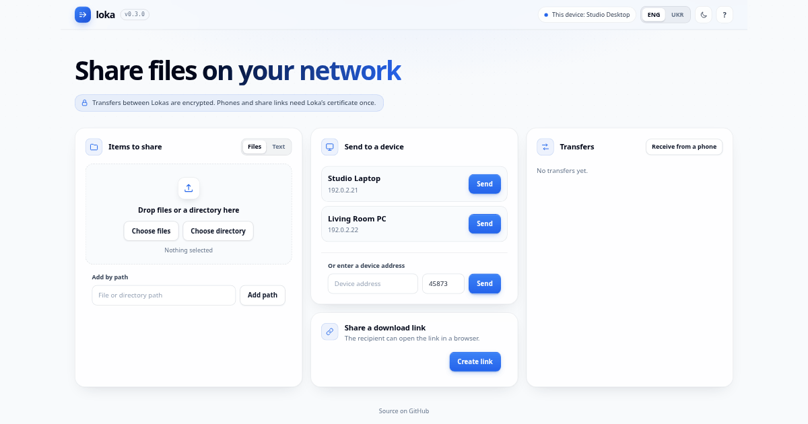

# Loka

[](https://github.com/sprytnyk/loka/releases/latest)
[](#install)
[](LICENSE)

[](https://codecov.io/gh/sprytnyk/loka)


Loka shares files, directories and text on your local network. Unpack and
run the executable for Linux, Windows or macOS. Loka opens in your browser.
You can also use it from the terminal. It works without an installer or
extra software.

You can send and receive from a browser on a phone or another computer.
Loka finds other computers running Loka on the same network. It encrypts
transfers and sends them directly between devices. It works without
internet access or an account.

<picture>
  <source media="(prefers-reduced-motion: reduce) and (prefers-color-scheme: dark)" srcset="docs/loka.png">
  <source media="(prefers-reduced-motion: reduce)" srcset="docs/loka-light.png">
  <source media="(prefers-color-scheme: dark)" srcset="docs/demo.gif">
  
</picture>

## Install

Download the archive for your computer from
[Releases](https://github.com/sprytnyk/loka/releases) and unpack it.
On Windows, double-click `loka.exe`. On Linux or macOS, run `./loka` from
the unpacked directory. To run `loka` from any directory, put the
executable in a directory on your `PATH`.

| Computer | Archive |
| --- | --- |
| Mac with Apple silicon | `loka_X.Y.Z_darwin_arm64.tar.gz` |
| Intel Mac | `loka_X.Y.Z_darwin_amd64.tar.gz` |
| Linux | `loka_X.Y.Z_linux_amd64.tar.gz` |
| Windows | `loka_X.Y.Z_windows_amd64.zip` |

> [!NOTE]
> If macOS blocks Loka because it doesn't recognise the developer, run
> `xattr -d com.apple.quarantine loka` once from the unpacked directory.

Put `SHA256SUMS` and `SHA256SUMS.asc` from the release alongside the archive.
Run this command to check the download.

```sh
gpg --verify SHA256SUMS.asc SHA256SUMS && sha256sum --ignore-missing -c SHA256SUMS
```

If you have Go, you can install Loka with
`go install github.com/sprytnyk/loka@latest`.

## Send and receive

Run `loka` on both computers. It opens in your browser.

1. Choose files or a directory, drop them on the page, or enter a path.
2. Select the receiving device. If it doesn't show up, enter its address and
   port.
3. On the receiving computer, choose an existing directory and accept within
   a minute. On the first transfer, check that both computers show the same
   pairing code before you accept.

Loka can receive several transfers at once. The browser and terminal show
the current speed during a transfer and the average speed when it finishes.
Loka remembers the last destination until you quit.

Loka uses your system theme and browser language by default. Use the header
to switch between light and dark or between English and Ukrainian. The
browser remembers your choices.

To choose files or directories, Loka uses zenity or kdialog on Linux, Finder on
macOS, and the Windows file dialog. If the picker is unavailable, drop files
or enter their paths.

Loka copies files you drop on the page because the browser keeps their
paths private. Loka removes those copies when you quit. Files you pick or
add by path stay in place. Loka skips symbolic links inside selected directories.

Loka writes incoming files to a hidden directory as they arrive, so the
receiver needs space for one copy. Once all the files arrive, Loka moves
them into place. If `report.pdf` already exists in the destination, Loka
saves the incoming file as `report (1).pdf` or uses the next free number.
Loka removes temporary files when a transfer fails. It sends files in one
stream for speed and doesn't resume interrupted transfers. If the connection
drops, send the files again.

> [!TIP]
> If the computers can't see each other, the Wi-Fi network may block
> connections between devices. On Windows, allow Loka through the firewall when
> asked.

## From a phone

On the computer, select **Receive from a phone**. Scan the QR code or open
the full link in the phone's browser. The part after `#r=` lets the phone
send. Loka changes it each time it starts.

Choose files or a directory and send them. The computer asks you to accept.
On iPhone and iPad, choose files because their browsers can't select directories.
To send text, switch to **Text** and paste it. See [Text](#text).

The first time, Loka shows how to install its certificate on Android or iPhone.
Install it once to open the page over HTTPS without a warning. If you skip it,
Loka still encrypts the connection and the browser warns that it can't verify
which computer answered.

If Loka shows several QR codes, use the one for the phone's network.
Loka can show a Tailscale address alongside a local address. It shows
other VPN addresses only when there is no local network.

## Download links

Add what you want to share and select **Create link**. Anyone with the link can
open it in a browser while you're sharing. Select **QR code** to show one code
per address for a phone to scan.

A link looks like `http://192.0.2.10:45873/#d=…`. The browser keeps the part
after `#` on the device. The page switches to HTTPS before it sends the
secret from the link. Each link also has an `https://` version. In the QR
code window, check **The phone has Loka's certificate** to show HTTPS codes.

> [!WARNING]
> An `http://` link opens a small page over plain HTTP first. Someone on the
> network who can change traffic could swap that page and steal the link. Once
> a phone has Loka's certificate, use the `https://` link instead. The same
> goes for the address in **Receive from a phone**.

Loka sends a single file in its original format, and the browser can
resume that download. For a directory or several files, Loka builds a ZIP
as the browser downloads it. Each download uses the current contents.
Deleting or replacing a shared file or directory stops the link.

## Text

In **Items to share**, select **Text** and type or paste a message. The
**Paste** button reads your clipboard if the browser allows it. Select a
device to send the text or select **Create link** for a phone.

- The receiving computer shows the text in a window with a **Copy** button.
  Loka keeps the text in memory until you close the window.
- If either device is new to the other, compare the pairing codes and
  accept on the receiving computer. Once both devices remember each
  other, the receiver shows the text as it arrives.
- On a phone, open the link from **Receive from a phone** and select **Text**.
  The text appears on the computer at once.
- A text link shows the text with a **Copy** button. It works until you stop
  sharing or quit Loka.

Loka accepts up to 1,048,576 bytes of text. Run `loka receive` to read it
in the terminal.

## Command line

```sh
loka receive
loka devices
loka send --to 192.0.2.10 /path/to/file /path/to/directory
printf '%s' 'Hello' | loka send --to 192.0.2.10 --stdin
loka share /path/to/file
loka forget my-laptop
```

- `receive` asks where to save files. Press Enter to use the current directory
  on the first transfer or the last destination on later transfers. Enter `n`
  to decline a file. When either device is new to the other, `receive` asks
  whether to accept text. Press Enter to decline the text. Text sent through
  the phone link appears right away.
  `receive` prints the phone link, its QR code, the HTTPS link and Loka's
  certificate fingerprint.
- `devices` lists devices running Loka on the same network. It marks a device
  as remembered only when it shows the certificate Loka knows for it.
- `send` takes the receiver's address. Use `--stdin` to pipe in UTF-8 text.
- `share` prints HTTP and HTTPS links and a QR code for each local address.
  It also prints the certificate's fingerprint and a `curl` command. The
  links work until you press Ctrl+C. Use `--address` to print links for just
  one address.
- `forget` removes a device from the remembered list.

The `curl` command uses `-k` because curl doesn't trust Loka's certificate by
default. The `--pinnedpubkey` option checks that the server presents the
expected public key before curl sends the link.

Run `loka -h` for all options and `loka --version` for the version.
If the default port is busy, `loka --port 0` picks a free port automatically.
You can also choose a port, for example with `loka --port 45000`.
Transfer status, help and errors are in colour in a terminal. Set `NO_COLOR=1` to turn that off.

## Safety

| Between | Encrypted |
| --- | --- |
| Two computers running Loka | Yes |
| A phone's browser and Loka | Yes |
| Download links | Yes |

Loka opens its page at `http://127.0.0.1`, an address that only works on
your computer. The **?** button explains how Loka protects transfers.
For connection and transfer details, see [PROTOCOL.md](PROTOCOL.md).

Loka makes a certificate on its first run and keeps it in your settings
directory. It uses `~/.config/sprytnyk.dev/Loka` on Linux,
`~/Library/Application Support/sprytnyk.dev/Loka` on macOS and
`%AppData%\sprytnyk.dev\Loka` on Windows. Both devices mark each other as
new on the first transfer.

Loka calculates a six-digit pairing code from both certificates and a
random number from each side. Both devices show the code.

> [!IMPORTANT]
> On the first transfer, accept only if both devices show the same pairing
> code. A mismatch can mean another device is passing traffic between them.

Once you accept the first transfer, both computers remember each other's
certificates. Loka refuses a transfer if a remembered device shows a
different certificate. A copy of Loka with a fresh settings directory
shows up as a new device.

Loka keeps its browser certificate authority in the same directory. Installing
it on a phone lets the browser check which computer answered. The certificate
only covers local network addresses, so someone can't use it to pose as a
public website. Loka leaves the computer's trusted certificates alone.

When a phone opens an `http://` link or QR code, it loads the first page
over plain HTTP. That page sends the phone to HTTPS and offers the
certificate over plain HTTP. Someone who can change network traffic could
swap the page or the certificate. Once the phone trusts the certificate, use
`https://` links to skip the first page.

> [!IMPORTANT]
> Before you trust the certificate, compare its SHA-256 fingerprint in the
> phone's settings with the one on the computer. Open **?** on the computer's
> Loka page or read the fingerprint printed by `loka receive` or `loka share`.
> Someone who swaps the certificate could also swap the page on the phone.
>
> On Android, search Settings for "Trusted credentials" and open the **User**
> tab. On iPhone, open **Settings › General › VPN & Device Management**, then
> the Loka profile and **More Details**. Use the fingerprint in the phone's
> settings. The browser's padlock shows the certificate for the address
> you're visiting, with its own fingerprint.

> [!CAUTION]
> Anyone with the link can download while you're sharing. Send it only
> to the people you want to share with. When you're done, select
> **Stop sharing** or press Ctrl+C after `loka share`.

## How Loka compares

| Tool | What you run on a computer | Browser on another device | Where it works | File encryption |
| --- | --- | --- | --- | --- |
| **[Loka](https://github.com/sprytnyk/loka/releases/latest)** | One file with a built-in web page and terminal commands | Send and receive in a browser on the same network. You accept each upload to the computer. | Finds other Loka devices on the same network. Works without internet access. | End-to-end encrypted |
| [croc](https://github.com/schollz/croc) | One terminal program | Use a code to send or receive on the [croc website](https://getcroc.com/). | Local terminal transfers work without internet access. The website and some internet transfers use a remote server to forward files. | End-to-end encrypted |
| [st](https://github.com/chyok/st) | One terminal program | Send and receive in a browser on the same network. st saves uploads automatically. | Finds other st devices on the same network. Works without internet access. | Plain HTTP |
| [LocalSend](https://localsend.org/) | Desktop app or separate terminal tool | Send and receive in a browser on the same network. LocalSend also has a separate [web app](https://github.com/localsend/web). | Desktop and phone apps work on the same network without internet access. By default, the web app uses a remote server to connect devices. | Encrypts app transfers by default |
| [Flashbyte](https://github.com/iamsami101/Flashbyte) | Desktop app | Flashbyte app on both devices | Local network. Works offline. | Supports TLS |
| [Upgopher](https://wanetty.github.io/upgopher/) | One file with a built-in web page | Upload and download from the shared directory. | Connect to the computer on your local network. You can also set up access over the internet. | Optional HTTPS and browser file encryption |
| [Dropwire](https://muhamadjawdatsalemalakoum.github.io/dropwire/) | Desktop app | Dropwire app on both devices | Finds devices on the same network and can send over the internet. A public server forwards files when a direct connection fails. | End-to-end encrypted |
| [PeerPayload Connect](https://github.com/Aditya-Karn234/PeerPayload) | Windows or Linux app | Connect app on both devices. It also has an Android app. | Works on the same network or over the internet. A server helps devices connect. If they can't connect directly, a server forwards the files. | End-to-end encrypted |

## Development

Run `make check` to lint and test the code. The lint check needs
[golangci-lint](https://golangci-lint.run/docs/welcome/install/) v2. Run
`make format` to format the code. `make test-large` sends a file over 8 GiB
and needs at least that much free disk space.

`make build` puts the executable for your computer in `dist/loka`.
`make release` checks that the build for your computer runs and puts the
release archives in `dist/`.

`make screens` generates the English and Ukrainian screenshots in both
themes. It needs Node.js and Chromium.
`make gif` also records the README demos and needs ffmpeg.
